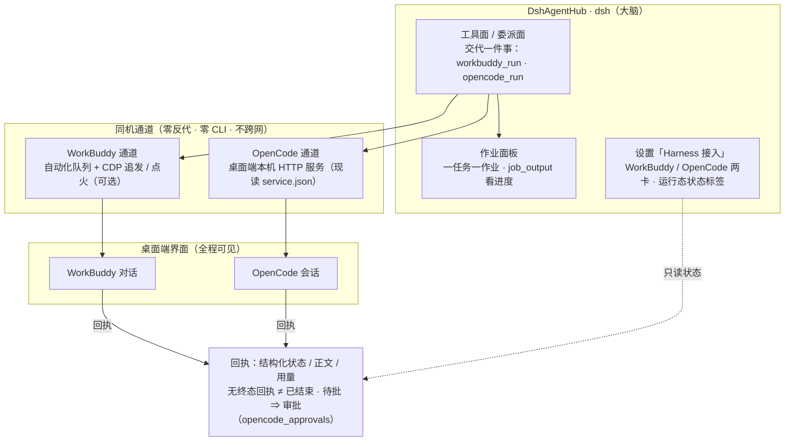

# DshAgentHub

DshAgentHub 把本机 agent（首个 WorkBuddy）变成看得见、可调度、可观测的执行方。全程同机，不跨网。

> **项目最高准则：[CHARTER.md](./CHARTER.md)** —— 2026-10-15 项目定义更新：dsh 作为大脑，向本机桌面 harness 下发可视化任务（八步流程：创建对话 → 工作目录 → 模型 → 思考强度 → 下发 → 会话复用 → 回执 → 审批）。凡本仓库文档与该准则冲突处，以 CHARTER 为准，并登记待修。
>
> 一 harness 一包：`packages/plugin-workbuddy`（WorkBuddy 桌面端，下文能力面以它为准）与
> `packages/plugin-opencode`（OpenCode 桌面端，2026-10-15 落地，见包内 README）。
> 设置页里两者由 `packages/plugin-harness-hub` 合并为**「Harness 接入」父条目**下的两个标签页
> （各卡抬头是运行态**状态标签**：未开启 / 未启动 / 工作中 / 任务下发中…）。

---

## 交代的事，两边各留一样东西

交代的事在 WorkBuddy / OpenCode 里是一条可见对话，在 DshAgentHub 里是一条回执。

---

## 能力

| 能力 | 说明 |
|---|---|
| 下发任务 | `workbuddy_run` 交代一件事，DshAgentHub 作业面板里有一个对应的作业。 |
| 多轮归组 | 同 `session_key` 可二次下发；默认每轮都是新对话，见下一条。 |
| 会话复用（多轮追问） | 设置 `enableMultiTurnFollowUp` 开启后：`resume:true` 且记性命中 ⇒ 追发进**同一条对话**继续干（桌面端可见）；追发失败自动回退点火新开，回执与状态卡带 `fallback` 原因。默认关闭。 |
| 直接点火（免排队） | 设置 `enableDirectIgnition` 开启后（默认关）：点火轮经桌面端 CDP 直接建对话并下发，**零计划任务 INSERT**。派发**前**失败照旧回退自动化队列（回执带 `fallback` / `fallbackReason`，任务不丢）；派发**后**失败**绝不回退**——同一条 prompt 再跑一遍就是双份积分。前置条件见「已知限制」。 |
| 模型与推理强度 | 下发时可选模型与推理强度（6 档），都不指定时按最省的兜底，实际用了哪个以回执为准。 |
| 每日签到自动领取 | Buddy 加油站每日积分：状态面读到"活动进行中且今日未签"时在后台顺手领掉（先查后领、领完复核，幂等；今日已领/非活动季静默收尾）。开关 `enableAutoCheckin` 默认开，关掉即停。 |
| 积分只读显示 | 设置卡片上有一行「剩余积分」，只读展示，读不到就明说读不到。 |
| 启动清理 | 插件启动时回收上一次遗留的下发记录，不留会自己再跑的活任务。 |

OpenCode 侧同款能力：创建 / 复用**可见会话**、下发、等待回执、审批列待批 + 回复、精准清理 ——
工具名与用法见 [`packages/plugin-opencode/README.md`](./packages/plugin-opencode/README.md)。

---

## 非目标

- 不做 CLI 控制：不自己拉起任何 agent 进程下发任务；
- 不做网关反代理：不把 WorkBuddy 冒充成 DshAgentHub 的一台模型，不重托管任何模型路由；
- 不做 GUI 自动化：不模拟点击，不读界面像素；
- 不跨网：状态接口只接受本机请求，任务数据不出这台机器。

---

## 架构



两个入口（工具面 / 委派面）、两条同机通道（WorkBuddy：自动化队列 + CDP 追发·点火；OpenCode：桌面端本机 HTTP 服务）。任务落在桌面端自己的界面里、看得见；dsh 拿回结构化回执（状态 / 正文 / 用量），需要人拍板的节点走审批。

---

## 安装

### 前置

| 条件 | 说明 |
|---|---|
| Node.js **≥ 22.5.0** | 见 `package.json` 的 `engines` |
| DshAgentHub（核心为 DeepSeek Harness / dsh） | 本机已安装；三个插件以 junction 装载进它的 profile（见下） |
| WorkBuddy **桌面端**（用 WorkBuddy 通道时） | **已启动并已登录** —— 插件借用它的登录态，自己不持有任何账号凭据；追发 / 点火另需一次性调试端口配置（见「已知限制」，一次性设好后长期有效） |
| OpenCode **桌面端**（用 OpenCode 通道时） | **已启动**（v2.0.x）—— 插件经它**自己的本机 HTTP 服务**下发（地址与口令现读 `~/.local/state/opencode/service.json`），不代启停桌面端 |

### 步骤

```powershell
git clone https://github.com/Zoupidan/DshAgentHub.git
cd DshAgentHub

node -v                 # 确认 >= 22.5.0

# ① 把三个插件包的 @deepseek-ai/* 依赖指向本机 DshAgentHub 安装体（Windows 上是目录 junction）
npm run link:dsh-deps
```

② **把三个包装载进你的 DshAgentHub profile**（`dsh-plugin-workbuddy` / `dsh-plugin-opencode` /
`dsh-plugin-harness-hub`）：

- profile 的 `package.json`：把三个包加入 `dependencies`，并把它们加入 **bundles 装载清单**；
- profile 的 `node_modules/`：为每个包建 **junction** 指向本仓库对应 `packages/plugin-*` 目录
  （本机示例：`%USERPROFILE%\.dsh\profiles\desktop\node_modules\dsh-plugin-opencode`
  → `…\DshAgentHub\packages\plugin-opencode`）；
- **重启 DshAgentHub 生效**（插件在宿主启动时装载，无热载；改完源码同样重启才生效）；
- **启用**：设置 → **Harness 接入** → 对应卡片打开「启用」（三卡默认关；关着时零下发，不往桌面端写任何东西）。

两点补充，避免踩坑：

- 本仓库**刻意不执行 `npm install`**：`@deepseek-ai/*` 依赖不发布到 npm，全部通过 `link:dsh-deps` 的目录 junction 指向你本机的 DshAgentHub 安装体（重复执行幂等、断链自愈）。
- `npm run test:host` 的 4 条真库护栏需要本机存在 WorkBuddy 真库（`~/.workbuddy/workbuddy.db`，只读）；没装 WorkBuddy 的机器上这几条会**显式跳过**（可见的 SKIP，不是静默通过），其余测试不受影响。

---

## 使用

工具只暴露给主控模型（WorkBuddy：`workbuddy_run` / `workbuddy_status`；OpenCode：`opencode_run` / `opencode_status` / `opencode_approvals` / `opencode_purge`）。调不调用由 LLM 自主决定，人在 DshAgentHub 里只管交代事。总开关决定是否启用：关则零下发，不往桌面端写任何东西。

---

## 设置卡片

设置 → **Harness 接入 → WorkBuddy** 那张卡片（DshAgentHub 插件）显示五样东西：**模型与倍率**、**推理强度档位**、**剩余积分**、**每日签到**、**运行状态**；卡抬头是运行态**状态标签**（未开启 / 未安装 / 检测中 / 工作中（N）/ 未启动 / 功能受限 / 已启动 / 已开启 —— 桌面端死活以真实归因码为证据，无证据只说到「已开启」，不硬说「已启动」）。OpenCode 卡片在相邻标签页，同款位置另见其包内 README。

- 模型后面带倍率标注（如 `x0.51`）；没有倍率的显示"倍率未知"，仍然可选；
- 推理强度档位来自桌面端的实际能力表，标注哪些可选、哪些置灰；
- 积分读不到时显示"暂时读不到"，不显示为 `0`；
- 每日签到行显示「今日已领（今日 +N，连签 M 天）」/「今日未领，将自动领取」/「签到活动已结束」；配置组里有「自动领取每日积分」开关（默认开，关掉即停，只读状态不停）；
- 运行状态区会说明最近一次下发是「**复用上次对话续发**」还是「**续发失败，已回退新开对话**」；内部通道、耗时与原因码收在"任务详情"折叠里。

> **调试端口（`enableDirectIgnition` / `enableMultiTurnFollowUp` 的前置）**：一次性**用户级**环境变量 `WORKBUDDY_REMOTE_DEBUGGING_PORT=9222`——设置后**每次启动都带调试口，一次配置长期有效**（未配置时任务照跑不丢，自动回退路线见「已知限制」）。模型侧的 `workbuddy_status` 会给出 `cdp` / `ignition` 两块**只读**结论——插件不代设环境变量、不代杀也不代重启 WorkBuddy。

---

## 状态接口

同一份数据也能从本机状态接口读到（**只接受本机请求**，非本机来源返回 403）：

```powershell
$DSH_WEB = 'http://127.0.0.1:19387'   # ← 换成你 DshAgentHub Web 的端口

$s = (Invoke-WebRequest -UseBasicParsing -Uri "$DSH_WEB/plugin-workbuddy/status").Content | ConvertFrom-Json

"registry        = $($s.registry)"
"modelsSource    = $($s.modelsSource)"
"models.count    = $($s.models.Count)"
"credits.ok      = $($s.credits.ok)  remain=$($s.credits.remain)"
```

`modelsSource` 以 `desktop-live:` 开头表示目录与倍率来自桌面端实时接口；以 `desktop-cache:` 开头表示已回落到本地缓存，目录可能偏少、倍率可能过期。

积分只在这个接口的 `credits` 字段里，`workbuddy_status` 工具输出里没有，去工具面找不到不是问题。

OpenCode 侧同一套（同样只接受本机请求，只读）：

```powershell
$s2 = (Invoke-WebRequest -UseBasicParsing -Uri "$DSH_WEB/plugin-opencode/status").Content | ConvertFrom-Json

"registry  = $($s2.registry)"
"inFlight  = $($s2.inFlight.Count)"
"lastRun   = $($s2.lastRun.outcome)"
```

---

## 发布

**2026-10-10 起：不再提供打包发布版，本仓库只提供源码。**

- GitHub Releases 与版本 tag（v0.2.1 / v0.2.2 / v0.2.3）已于 2026-10-10 全部删除；
- 本地 `tmp/release-pack/` 下的历史 zip 已清除；仓库内无打包 / 发布工作流（`ci.yml` 只跑红线与测试）；
- 误建的发布仓库 `Zoupidan/dsh-plugin-workbuddy` 已 archive 只读封存。

部署方式只有一条：profile 的 `node_modules/dsh-plugin-*` 以 **junction 指向本仓库对应的
`packages/` 目录**（三个包：workbuddy / opencode / harness-hub，装载步骤见「安装」），
改仓库即改所有 profile，**重启 DSH 生效**。更新 = 拉源码 + 重启。

验收以回执与桌面端对话为准：交代的事在 WorkBuddy / OpenCode 里是一条**可见对话**，在 DshAgentHub 里是一条**回执**。
版本记录见 [CHANGELOG.md](./CHANGELOG.md)。

---

## 已知限制

### WorkBuddy 通道

- **推理强度以桌面端的实际口径为准**。插件保证把选定的档位写进下发请求，能否生效由桌面端决定，实际生效情况以回执为准。
- **多轮归组默认每轮都是新对话**；`enableMultiTurnFollowUp` 开启后（默认关）才会在记性命中时续接同一条对话，且追发失败会自动回退新开，任务不丢。
- **模型 / 思考强度只识别、不改动**。追发轮不发送任何模型或强度设定，只读回报该对话的当前设定（回执 `follow_up.conversationModel` / `conversationEffort`，读不到为 `null`）；你在 WorkBuddy 桌面端手动改过的值会被如实带回，插件不复位、不回写。
- **追发会真实消耗 WorkBuddy 积分**（实测约 0.01–0.4 credit/轮，随 prompt 大小浮动）；计费记账目前未接入，由桌面端账单为准。
- **调试端口 = 一次性配置，设好即长期有效**：用户级环境变量 `WORKBUDDY_REMOTE_DEBUGGING_PORT=9222` 设置后**每次启动都带调试口**（本机已完成配置，且真机验证过同会话追发：复述暗号 + 落库单会话）。未配置时任务照跑不丢：追发回退点火路线、直接点火回退计划任务队列，回执与状态卡带 `fallback` / `fallbackReason`。**插件只告知、只询问**——不代设环境变量、不代杀、不代重启 WorkBuddy；绝不静默回退、绝不把回退的那一轮说成走 direct。
- **建议先正常用过 WorkBuddy 再点火**：插件从本机数据解析"当前登录账号"来归属下发记录；全新安装且桌面端从未有过任何会话记录时，归属解析可能拿不到值，点火行会以无主形态写入（桌面端是否派发取决于其版本行为）。
- **积分有结算延迟**（约一分钟），读数自带新鲜度标注；刚跑完立刻读到的可能是旧值。

### OpenCode 通道

- **服务不在 ⇒ 如实报 `service_missing`**（含查过哪些路径的证据清单）；插件**不代启停** OpenCode 桌面端，人去开。
- **审批：面已通、真实闭环待验** —— 列待批 + 回复决定两端已实测（含 404 归因修复）；「真实 tool-call 触发问询 → 回复 → 续跑」整链待真实场景触发。
- **wait 超时（默认 900000ms，工具侧夹 5s–1h）不中断任务**：只把在途态如实回传；同会话可再附着等结果（**无终态回执 ≠ 已结束**）。桌面端 2.0.29 兼容待验。

### 通用

- 只在 Windows 上验证过；跨平台未验证。
- 活动区为 ESM JS，不做类型检查；测试状态以 CI 输出为准。

---

## 安全边界

- **自建自回收**：插件只写自己建的一次性下发记录，终态（成功/失败/超时/取消）一律回收，启动时再扫一遍遗留，不留会自己再跑的活任务；
- **OpenCode 只经桌面端本机服务**：地址与口令现读 `service.json`；password 只在解析当刻与 HTTP 客户端内存里流转（不进日志 / 证据 / 载荷，机器门禁钉死）；非回环地址一律拒绝（fail-closed）；
- **凭据不回显**：插件不持有、不存储、不回显任何账号凭据，凭据不进日志、作业输出与错误文案，仓库有机器门禁守这条；
- **测试护栏**：跑测试必须带护栏（`node --import ./tools/dev/test-home-guard.mjs`），绕过护栏的测试可能写进真实数据。

---

## 贡献与许可

欢迎提 issue。[MIT](./LICENSE)。安全问题不要开公开 issue，请走 GitHub 私有漏洞报告（仓库页面 → Security → Report a vulnerability）。
